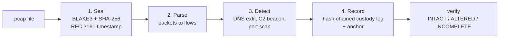

# Concepts

NetForensics has one idea behind every design choice: **a result is only useful if you can
explain it and prove it was not altered.** Tools such as Zeek and Suricata already detect
the traffic patterns well. What this project adds is the sealing and the proof.

## The pipeline

1. **Seal.** The whole file is hashed and the hash is sent to a timestamp authority before
   any code reads the packets. Parsing bugs cannot change what was sealed.
2. **Parse.** Packets become [flows](flows.md): one record per connection.
3. **Detect.** Each [detector](detectors.md) is a short rule over flows. A finding carries its
   own evidence sentence.
4. **Record.** Every event goes into an append-only, hash-chained
   [custody log](evidence-layer.md#the-custody-chain), and the chain's head is timestamped.

Later, `verify` re-derives everything it can from the stored bytes and tells you whether
the case still matches.

## Why no machine learning

"The model flagged it" does not survive a follow-up question. "This subdomain has entropy
4.2 where ordinary names sit near 2.5" does. Every detector is a transparent rule: Shannon
entropy, timing statistics, fan-out counts. The tradeoff is deliberate: explainability over
sophistication.

## Pages in this section

- [Flows](flows.md): what the parser produces and what it ignores.
- [The detectors](detectors.md): what each rule measures and when it fires.
- [The evidence layer](evidence-layer.md): sealing, timestamps, the custody chain,
  anchoring and verification.
